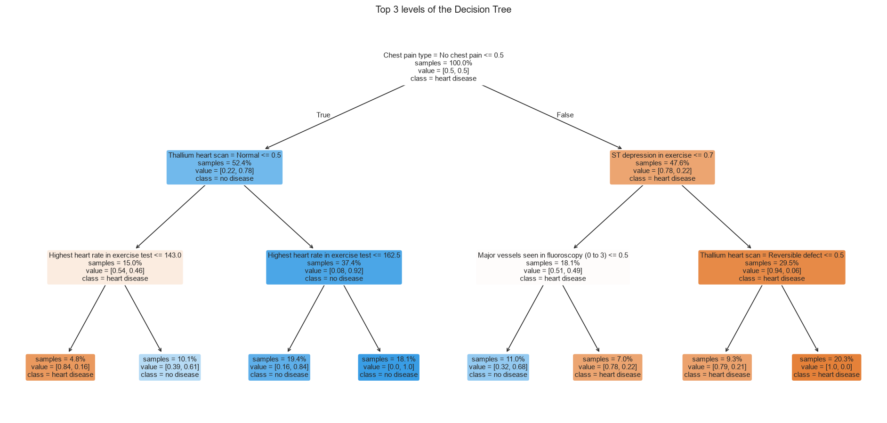

# Disease risk

Estimates whether a patient has heart disease with a Decision Tree and Naive Bayes, and tests how far that holds: at other cut-offs and at other hospitals. Built on the UCI Heart Disease data, with an interactive demo that explains each verdict.

**Educational only. Not a medical tool.**



## Results

Trained on 227 Cleveland Clinic patients; test set of 76 (stratified), never used for tuning or model choice. 46% of patients have heart disease.

| Model | Accuracy | Balanced accuracy | Recall | Precision | ROC-AUC |
| --- | --- | --- | --- | --- | --- |
| **Naive Bayes** | 0.803 | 0.796 | 0.714 | 0.833 | 0.864 |
| **Decision Tree** (depth 3) | 0.750 | 0.741 | 0.629 | 0.786 | 0.777 |
| Random Forest (benchmark) | 0.789 | 0.780 | 0.657 | 0.852 | 0.865 |
| Always healthy (baseline) | 0.539 | 0.500 | 0 | 0 | 0.500 |

Recall and precision are for heart disease.

- **Naive Bayes matches the forest** on ROC-AUC and beats the tree. The tree's 8 leaves are easy to follow but lose detail.
- **The cut-off decides who is missed.** At 50%, Naive Bayes misses 10 of 35 sick test patients with 5 false alarms; at 20% it misses 6 with 12 false alarms.
- **Scan results matter most**: thallium scan, arteries seen in fluoroscopy, ST drop in the exercise test, and chest pain type. Patients with no chest pain are the most likely to be sick, because something else got them referred.
- **It doesn't travel well.** Scored on three hospitals it never saw:

| Hospital | Patients | With heart disease | Naive Bayes accuracy | Naive Bayes ROC-AUC |
| --- | --- | --- | --- | --- |
| Budapest | 294 | 36% | 0.850 | 0.905 |
| Zurich and Basel | 123 | 94% | 0.699 | 0.768 |
| Long Beach (VA) | 200 | 75% | 0.610 | 0.721 |

At Zurich, Basel and Long Beach most scans weren't recorded and most patients were sick, so the Cleveland rules fit poorly.

Full tables and figures: [docs/results.md](docs/results.md). How it was done and the limits: [docs/methodology.md](docs/methodology.md).

## Run it

Needs Python 3.14+ and [uv](https://docs.astral.sh/uv/).

```bash
uv sync
uv run python main.py
uv run streamlit run app.py
```

`main.py` downloads the data once into `data/`, then writes figures, tables and the tree's rules to `outputs/`, models to `models/` and the tables to `docs/results.md`. Outputs and models are committed, so the demo works without running it.

## The demo

- **Overview**: what the project is, how both models decide, what was found and its limits.
- **Assess**: fill in a patient or start from a real test patient, and see each model's verdict: the inputs that pushed Naive Bayes, or the questions the tree asked.
- **Rules**: every rule the tree learned.
- **Results**: model comparison, cut-offs, other hospitals, mistakes, permutation importance and data checks.

## Layout

```
disease_risk/   spec.py (inputs and models), data.py (download, four hospitals),
                explain.py (Naive Bayes evidence, cut-offs, other hospitals), report.py
pxlab/          shared engine (vendored): data checks, pipelines, tuning, evaluation, tree rules, app helpers
main.py         the full study
app.py          the Streamlit demo
docs/           methodology, results, deploy
```

## Data

Janosi, Steinbrunn, Pfisterer and Detrano (1988), [Heart Disease](https://archive.ics.uci.edu/dataset/45/heart+disease), UCI Machine Learning Repository, CC BY 4.0. Collected at the Cleveland Clinic Foundation, the Hungarian Institute of Cardiology in Budapest, University Hospitals Zurich and Basel, and the VA Medical Center in Long Beach.

## License

MIT
