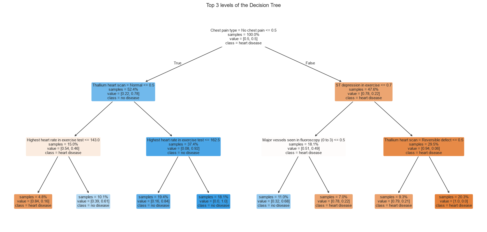
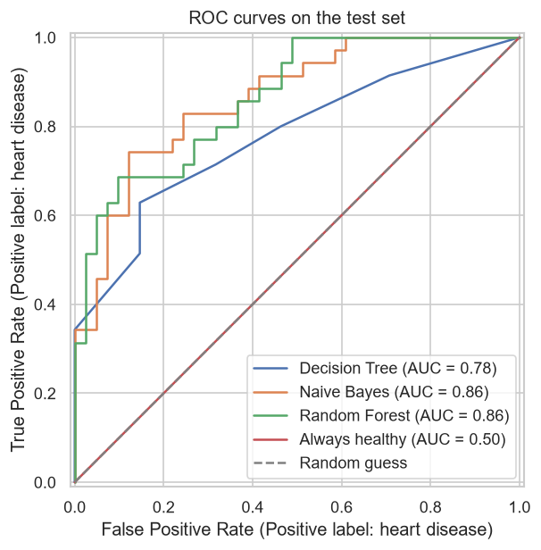
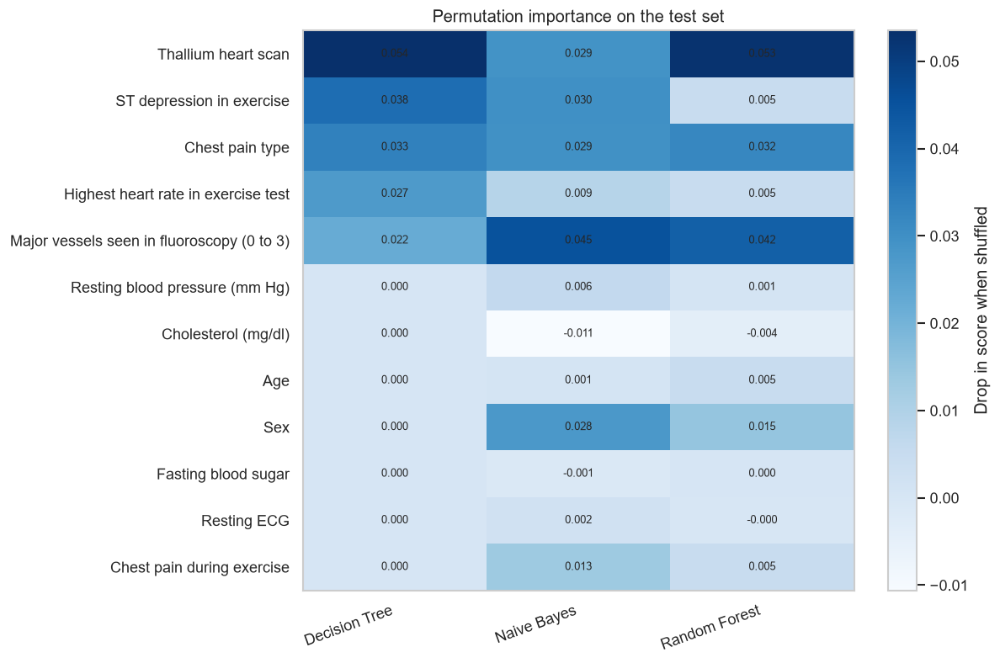
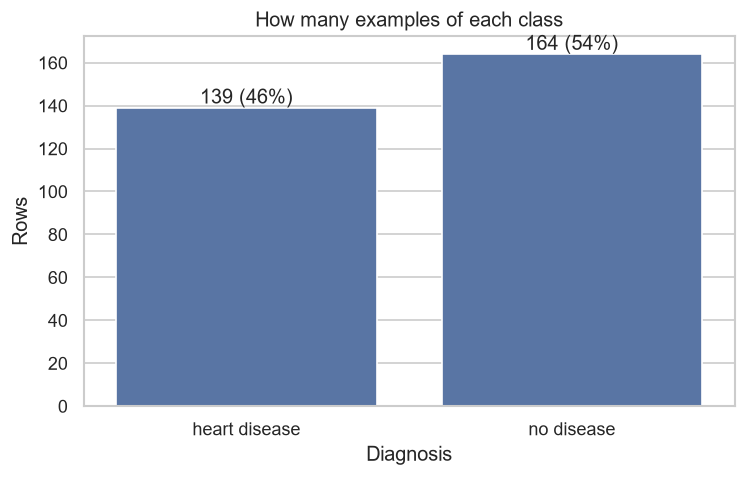
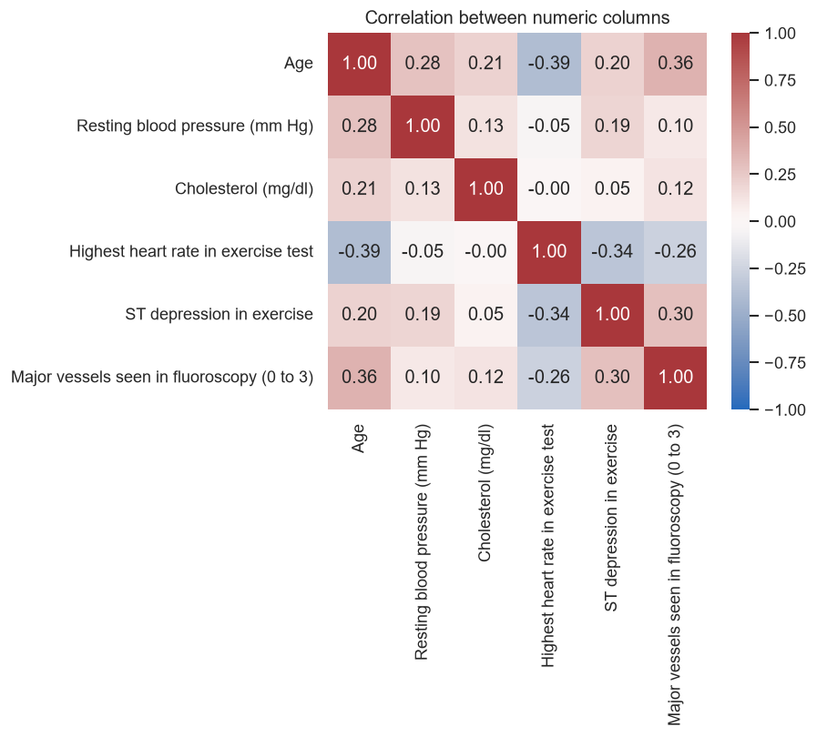

# Results

Produced by `python main.py`. The test set is 25% of the Cleveland patients, stratified, and was not used for tuning or model choice. The full rules of the tree are in `outputs/heart/tree_rules.txt`. Educational only, not a medical tool.

## Models

### Test-set scores (heart disease is the positive class)

| Model | Role | CV roc auc | Accuracy | Balanced accuracy | Precision | Recall | F1 | ROC-AUC |
| --- | --- | --- | --- | --- | --- | --- | --- | --- |
| Decision Tree | Main | 0.874 | 0.75 | 0.741 | 0.786 | 0.629 | 0.698 | 0.777 |
| Naive Bayes | Main | 0.917 | 0.803 | 0.796 | 0.833 | 0.714 | 0.769 | 0.864 |
| Random Forest | Benchmark beyond the course | 0.913 | 0.789 | 0.78 | 0.852 | 0.657 | 0.742 | 0.865 |
| Always healthy | Baseline | 0.5 | 0.539 | 0.5 | 0.0 | 0.0 | 0.0 | 0.5 |

## Cut-off

Patients flagged, missed and falsely alarmed on the test set as the cut-off moves.

### Naive Bayes

| Cut-off | Flagged | Missed (sick, not flagged) | False alarms (healthy, flagged) | Recall | Precision |
| --- | --- | --- | --- | --- | --- |
| 0.2 | 41 | 6 | 12 | 0.829 | 0.707 |
| 0.3 | 38 | 7 | 10 | 0.8 | 0.737 |
| 0.4 | 34 | 9 | 8 | 0.743 | 0.765 |
| 0.5 | 30 | 10 | 5 | 0.714 | 0.833 |
| 0.6 | 28 | 12 | 5 | 0.657 | 0.821 |
| 0.7 | 27 | 13 | 5 | 0.629 | 0.815 |

### Decision Tree

| Cut-off | Flagged | Missed (sick, not flagged) | False alarms (healthy, flagged) | Recall | Precision |
| --- | --- | --- | --- | --- | --- |
| 0.2 | 47 | 7 | 19 | 0.8 | 0.596 |
| 0.3 | 47 | 7 | 19 | 0.8 | 0.596 |
| 0.4 | 28 | 13 | 6 | 0.629 | 0.786 |
| 0.5 | 28 | 13 | 6 | 0.629 | 0.786 |
| 0.6 | 28 | 13 | 6 | 0.629 | 0.786 |
| 0.7 | 28 | 13 | 6 | 0.629 | 0.786 |

## Other hospitals

Models trained on Cleveland patients, scored on patients from three other hospitals they never saw. Several inputs are mostly missing at these hospitals.

### Scores per hospital

| Hospital | Patients | With heart disease | Model | Accuracy | Recall | ROC-AUC |
| --- | --- | --- | --- | --- | --- | --- |
| Hungarian Institute of Cardiology (Budapest) | 294 | 0.361 | Decision Tree | 0.813 | 0.613 | 0.83 |
| Hungarian Institute of Cardiology (Budapest) | 294 | 0.361 | Naive Bayes | 0.85 | 0.708 | 0.905 |
| Hungarian Institute of Cardiology (Budapest) | 294 | 0.361 | Random Forest | 0.82 | 0.594 | 0.9 |
| Hungarian Institute of Cardiology (Budapest) | 294 | 0.361 | Always healthy | 0.639 | 0.0 | 0.5 |
| University Hospitals (Zurich and Basel) | 123 | 0.935 | Decision Tree | 0.463 | 0.452 | 0.691 |
| University Hospitals (Zurich and Basel) | 123 | 0.935 | Naive Bayes | 0.699 | 0.704 | 0.768 |
| University Hospitals (Zurich and Basel) | 123 | 0.935 | Random Forest | 0.561 | 0.539 | 0.791 |
| University Hospitals (Zurich and Basel) | 123 | 0.935 | Always healthy | 0.065 | 0.0 | 0.5 |
| VA Medical Center (Long Beach, US) | 200 | 0.745 | Decision Tree | 0.615 | 0.591 | 0.645 |
| VA Medical Center (Long Beach, US) | 200 | 0.745 | Naive Bayes | 0.61 | 0.57 | 0.721 |
| VA Medical Center (Long Beach, US) | 200 | 0.745 | Random Forest | 0.58 | 0.483 | 0.728 |
| VA Medical Center (Long Beach, US) | 200 | 0.745 | Always healthy | 0.255 | 0.0 | 0.5 |

### Share of missing values per hospital

|  | Cleveland Clinic (US) | Hungarian Institute of Cardiology (Budapest) | University Hospitals (Zurich and Basel) | VA Medical Center (Long Beach, US) |
| --- | --- | --- | --- | --- |
| Age | 0.0 | 0.0 | 0.0 | 0.0 |
| Resting blood pressure (mm Hg) | 0.0 | 0.0 | 0.02 | 0.28 |
| Cholesterol (mg/dl) | 0.0 | 0.08 | 1.0 | 0.28 |
| Highest heart rate in exercise test | 0.0 | 0.0 | 0.01 | 0.26 |
| ST depression in exercise | 0.0 | 0.0 | 0.05 | 0.28 |
| Major vessels seen in fluoroscopy (0 to 3) | 0.01 | 0.99 | 0.96 | 0.99 |
| Sex | 0.0 | 0.0 | 0.0 | 0.0 |
| Chest pain type | 0.0 | 0.0 | 0.0 | 0.0 |
| Fasting blood sugar | 0.0 | 0.03 | 0.61 | 0.04 |
| Resting ECG | 0.0 | 0.0 | 0.01 | 0.0 |
| Chest pain during exercise | 0.0 | 0.0 | 0.01 | 0.26 |
| ST slope at peak exercise | 0.0 | 0.65 | 0.14 | 0.51 |
| Thallium heart scan | 0.01 | 0.9 | 0.42 | 0.83 |

## Which inputs matter

### Permutation importance (drop in ROC-AUC when the input is shuffled)

|  | Decision Tree | Naive Bayes | Random Forest |
| --- | --- | --- | --- |
| Thallium heart scan | 0.0535 | 0.0291 | 0.0528 |
| ST depression in exercise | 0.0383 | 0.0298 | 0.0047 |
| Chest pain type | 0.0334 | 0.0295 | 0.0322 |
| Highest heart rate in exercise test | 0.027 | 0.0086 | 0.0049 |
| Major vessels seen in fluoroscopy (0 to 3) | 0.0221 | 0.045 | 0.0415 |
| Resting blood pressure (mm Hg) | 0.0 | 0.006 | 0.0006 |
| Cholesterol (mg/dl) | 0.0 | -0.0106 | -0.0043 |
| Age | 0.0 | 0.0006 | 0.0049 |
| Sex | 0.0 | 0.0277 | 0.0148 |
| Fasting blood sugar | 0.0 | -0.0012 | 0.0001 |
| Resting ECG | 0.0 | 0.002 | -0.0003 |
| Chest pain during exercise | 0.0 | 0.0132 | 0.0046 |
| ST slope at peak exercise | 0.0 | 0.0013 | 0.0049 |

## Mistakes

### Test patients Naive Bayes got wrong

| age | resting_blood_pressure | cholesterol | max_heart_rate | st_depression | major_vessels | sex | chest_pain | high_fasting_sugar | resting_ecg | exercise_angina | st_slope | thallium_scan | Real | Predicted |
| --- | --- | --- | --- | --- | --- | --- | --- | --- | --- | --- | --- | --- | --- | --- |
| 57.0 | 154.0 | 232.0 | 164.0 | 0.0 | 1.0 | Male | Atypical angina | 120 mg/dl or below | Enlarged left ventricle | No | Rising | Normal | heart disease | no disease |
| 57.0 | 110.0 | 201.0 | 126.0 | 1.5 | 0.0 | Male | No chest pain | 120 mg/dl or below | Normal | Yes | Flat | Fixed defect | no disease | heart disease |
| 59.0 | 160.0 | 273.0 | 125.0 | 0.0 | 0.0 | Male | Typical angina | 120 mg/dl or below | Enlarged left ventricle | No | Rising | Normal | heart disease | no disease |
| 67.0 | 115.0 | 564.0 | 160.0 | 1.6 | 0.0 | Female | Non-anginal pain | 120 mg/dl or below | Enlarged left ventricle | No | Flat | Reversible defect | no disease | heart disease |
| 40.0 | 152.0 | 223.0 | 181.0 | 0.0 | 0.0 | Male | No chest pain | 120 mg/dl or below | Normal | No | Rising | Reversible defect | heart disease | no disease |
| 60.0 | 140.0 | 185.0 | 155.0 | 3.0 | 0.0 | Male | Non-anginal pain | 120 mg/dl or below | Enlarged left ventricle | No | Flat | Normal | heart disease | no disease |
| 50.0 | 140.0 | 233.0 | 163.0 | 0.6 | 1.0 | Male | Non-anginal pain | 120 mg/dl or below | Normal | No | Flat | Reversible defect | heart disease | no disease |
| 44.0 | 112.0 | 290.0 | 153.0 | 0.0 | 1.0 | Male | No chest pain | 120 mg/dl or below | Enlarged left ventricle | No | Rising | Normal | heart disease | no disease |
| 57.0 | 132.0 | 207.0 | 168.0 | 0.0 | 0.0 | Male | No chest pain | 120 mg/dl or below | Normal | Yes | Rising | Reversible defect | no disease | heart disease |
| 49.0 | 118.0 | 149.0 | 126.0 | 0.8 | 3.0 | Male | Non-anginal pain | 120 mg/dl or below | Enlarged left ventricle | No | Rising | Normal | heart disease | no disease |
| 63.0 | 145.0 | 233.0 | 150.0 | 2.3 | 0.0 | Male | Typical angina | Above 120 mg/dl | Enlarged left ventricle | No | Falling | Fixed defect | no disease | heart disease |
| 46.0 | 120.0 | 249.0 | 144.0 | 0.8 | 0.0 | Male | No chest pain | 120 mg/dl or below | Enlarged left ventricle | No | Rising | Reversible defect | heart disease | no disease |
| 53.0 | 142.0 | 226.0 | 111.0 | 0.0 | 0.0 | Male | No chest pain | 120 mg/dl or below | Enlarged left ventricle | Yes | Rising | Reversible defect | no disease | heart disease |
| 57.0 | 130.0 | 236.0 | 174.0 | 0.0 | 1.0 | Female | Atypical angina | 120 mg/dl or below | Enlarged left ventricle | No | Flat | Normal | heart disease | no disease |
| 65.0 | 138.0 | 282.0 | 174.0 | 1.4 | 1.0 | Male | Typical angina | Above 120 mg/dl | Enlarged left ventricle | No | Flat | Normal | heart disease | no disease |

## Data

### Data quality

| Column | Type | Missing | Distinct values |
| --- | --- | --- | --- |
| age | numeric | 0 | 41 |
| resting_blood_pressure | numeric | 0 | 50 |
| cholesterol | numeric | 0 | 152 |
| max_heart_rate | numeric | 0 | 91 |
| st_depression | numeric | 0 | 40 |
| major_vessels | numeric | 4 | 4 |
| sex | category | 0 | 2 |
| chest_pain | category | 0 | 4 |
| high_fasting_sugar | category | 0 | 2 |
| resting_ecg | category | 0 | 3 |
| exercise_angina | category | 0 | 2 |
| st_slope | category | 0 | 3 |
| thallium_scan | category | 2 | 3 |
| diagnosis | target | 0 | 2 |

