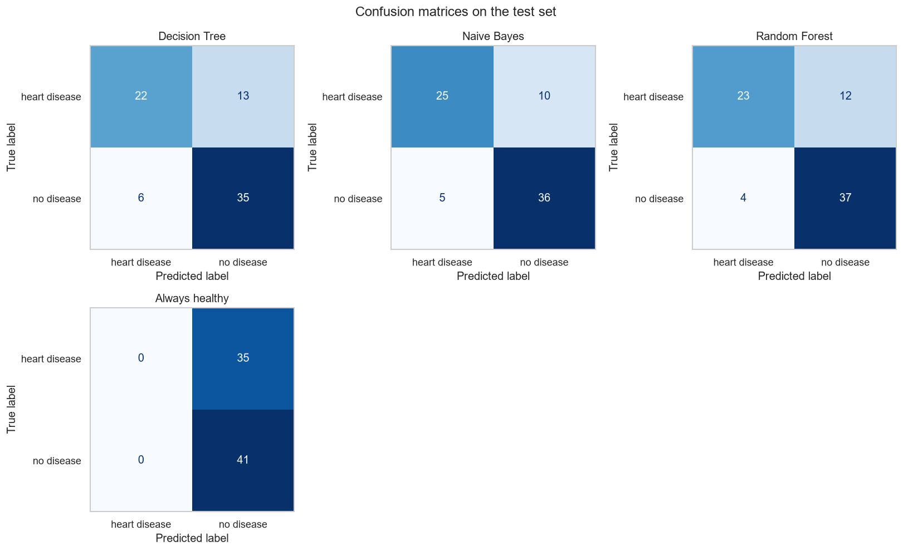
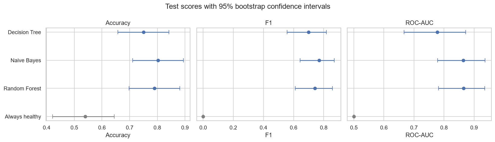
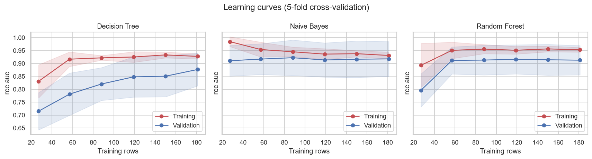
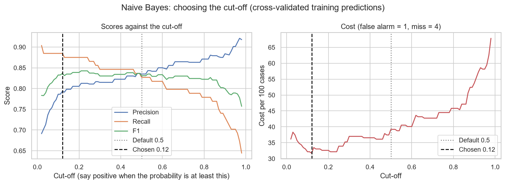
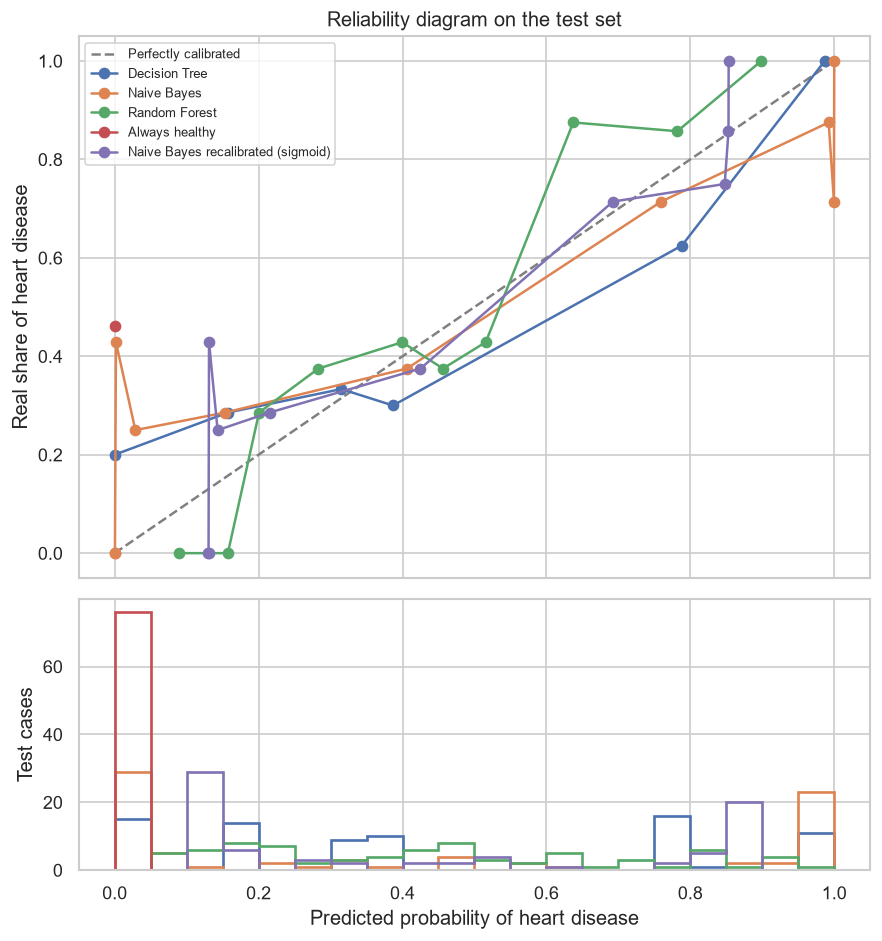
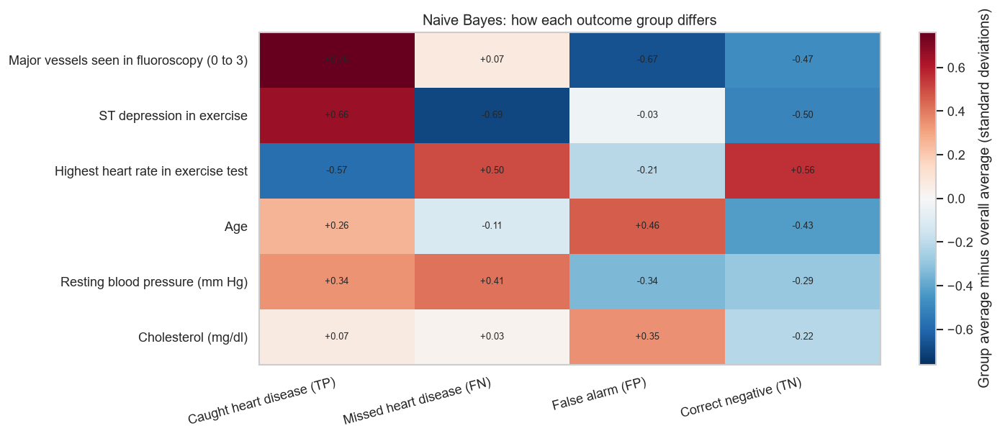
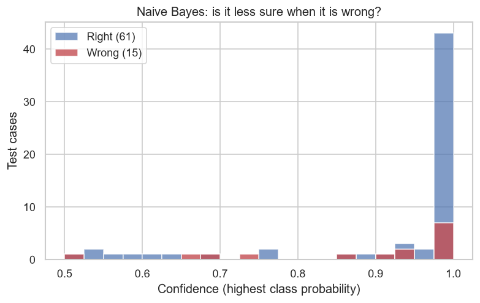

# Results

Produced by `python main.py`. The test set is 25% of the Cleveland patients, stratified, and was not used for tuning or model choice. The full rules of the tree are in `outputs/heart/tree_rules.txt`. Educational only, not a medical tool.

## Models

### Test-set scores (heart disease is the positive class)

| Model | Role | CV roc auc | Accuracy | Balanced accuracy | Precision | Recall | F1 | ROC-AUC |
| --- | --- | --- | --- | --- | --- | --- | --- | --- |
| Decision Tree | Main | 0.874 | 0.75 | 0.741 | 0.786 | 0.629 | 0.698 | 0.777 |
| Naive Bayes | Main | 0.917 | 0.803 | 0.796 | 0.833 | 0.714 | 0.769 | 0.864 |
| Random Forest | Benchmark beyond the course | 0.913 | 0.789 | 0.78 | 0.852 | 0.657 | 0.742 | 0.865 |
| Always healthy | Baseline | 0.5 | 0.539 | 0.5 | 0.0 | 0.0 | 0.0 | 0.5 |

## Key findings

### What the in-depth analysis found

| Finding |
| --- |
| Naive Bayes scores ROC-AUC 0.864 on the test set (95% interval 0.778 to 0.936); the baseline that ignores the inputs (Always healthy) scores 0.500. |
| Naive Bayes against Decision Tree on right or wrong answers (McNemar): could be chance (p = 0.455). |
| Naive Bayes against Random Forest on right or wrong answers (McNemar): could be chance (p = 1.000). |
| Naive Bayes against Always healthy on right or wrong answers (McNemar): real difference (p = 0.000). |
| Decision Tree generalises well: training and validation roc auc are close (+0.051); validation is still rising, so more data would likely help. |
| Naive Bayes generalises well: training and validation roc auc are close (+0.013); validation has levelled off, so more data alone would help little. |
| Random Forest generalises well: training and validation roc auc are close (+0.040); validation has levelled off, so more data alone would help little. |
| Cut-off for Naive Bayes: 0.12 instead of 0.5, chosen for the lowest cost. On the test set: recall 0.71 to 0.83, precision 0.83 to 0.71, cost per 100 cases 59.2 to 47.4. |
| Most honest probabilities: Random Forest (Brier 0.153); Naive Bayes has Brier 0.179 and calibration error 0.173. |
| The input that most separates caught from missed heart disease is ST depression in exercise: average 1.7 when caught, 0.233 when missed. |
| When Naive Bayes is at least 90% sure it is right 83% of the time (78% of test cases). |

## Reliability

Bootstrap 95% intervals: how much each test score could move with a different test sample.

### Confidence intervals

| Model | Score | Test value | Low | High |
| --- | --- | --- | --- | --- |
| Decision Tree | Accuracy | 0.75 | 0.6579 | 0.8421 |
| Decision Tree | F1 | 0.6984 | 0.5573 | 0.8169 |
| Decision Tree | ROC-AUC | 0.7774 | 0.6669 | 0.8717 |
| Naive Bayes | Accuracy | 0.8026 | 0.7105 | 0.8947 |
| Naive Bayes | F1 | 0.7692 | 0.6428 | 0.8696 |
| Naive Bayes | ROC-AUC | 0.8641 | 0.7785 | 0.9363 |
| Random Forest | Accuracy | 0.7895 | 0.6974 | 0.8816 |
| Random Forest | F1 | 0.7419 | 0.6101 | 0.8571 |
| Random Forest | ROC-AUC | 0.8648 | 0.7821 | 0.9355 |
| Always healthy | Accuracy | 0.5395 | 0.4211 | 0.6447 |
| Always healthy | F1 | 0.0 | 0.0 | 0.0 |
| Always healthy | ROC-AUC | 0.5 | 0.5 | 0.5 |

### Is the best model really better? (paired tests)

| Best model | Compared with | Best is better on | Other is better on | Test | p-value | Verdict |
| --- | --- | --- | --- | --- | --- | --- |
| Naive Bayes | Decision Tree | 10 | 6 | McNemar | 0.4545 | Could be chance |
| Naive Bayes | Random Forest | 4 | 3 | McNemar | 1.0 | Could be chance |
| Naive Bayes | Always healthy | 25 | 5 | McNemar | 0.0003 | Real difference |

### Learning curves

| Model | Training rows | Training score | Validation score |
| --- | --- | --- | --- |
| Decision Tree | 27 | 0.8305 | 0.7148 |
| Decision Tree | 57 | 0.9164 | 0.7809 |
| Decision Tree | 88 | 0.9216 | 0.8203 |
| Decision Tree | 119 | 0.9249 | 0.8478 |
| Decision Tree | 150 | 0.933 | 0.8505 |
| Decision Tree | 181 | 0.9273 | 0.8764 |
| Naive Bayes | 27 | 0.9846 | 0.9103 |
| Naive Bayes | 57 | 0.9539 | 0.9168 |
| Naive Bayes | 88 | 0.9451 | 0.9221 |
| Naive Bayes | 119 | 0.936 | 0.9133 |
| Naive Bayes | 150 | 0.9377 | 0.9163 |
| Naive Bayes | 181 | 0.9308 | 0.9175 |
| Random Forest | 27 | 0.8925 | 0.7958 |
| Random Forest | 57 | 0.9506 | 0.9115 |
| Random Forest | 88 | 0.9555 | 0.913 |
| Random Forest | 119 | 0.951 | 0.9158 |
| Random Forest | 150 | 0.9562 | 0.9141 |
| Random Forest | 181 | 0.9529 | 0.9125 |

## Cut-off and calibration

The cut-off is chosen on cross-validated training predictions, then checked on the test set. Costs: a false alarm costs 1, a miss costs 4. An assumption for this demo: a missed patient goes untreated, a false alarm costs one more test.

### Default against tuned cut-off on the test set

| Model | Cut-off | Threshold | Precision | Recall | F1 | Accuracy | Cost per 100 cases | TP | FP | FN | TN |
| --- | --- | --- | --- | --- | --- | --- | --- | --- | --- | --- | --- |
| Decision Tree | Default | 0.5 | 0.786 | 0.629 | 0.698 | 0.75 | 76.316 | 22 | 6 | 13 | 35 |
| Decision Tree | Tuned | 0.19 | 0.596 | 0.8 | 0.683 | 0.658 | 61.842 | 28 | 19 | 7 | 22 |
| Naive Bayes | Default | 0.5 | 0.833 | 0.714 | 0.769 | 0.803 | 59.211 | 25 | 5 | 10 | 36 |
| Naive Bayes | Tuned | 0.12 | 0.707 | 0.829 | 0.763 | 0.763 | 47.368 | 29 | 12 | 6 | 29 |
| Random Forest | Default | 0.5 | 0.852 | 0.657 | 0.742 | 0.789 | 68.421 | 23 | 4 | 12 | 37 |
| Random Forest | Tuned | 0.28 | 0.633 | 0.886 | 0.738 | 0.711 | 44.737 | 31 | 18 | 4 | 23 |
| Always healthy | Default | 0.5 | 0.0 | 0.0 | 0.0 | 0.539 | 184.211 | 0 | 0 | 35 | 41 |
| Always healthy | Tuned | 0.02 | 0.0 | 0.0 | 0.0 | 0.539 | 184.211 | 0 | 0 | 35 | 41 |

### How honest the probabilities are

| Model | Brier score | Calibration error | Mean predicted | Real positive share |
| --- | --- | --- | --- | --- |
| Decision Tree | 0.1908 | 0.1088 | 0.439 | 0.4605 |
| Naive Bayes | 0.1786 | 0.1726 | 0.4319 | 0.4605 |
| Random Forest | 0.1532 | 0.1233 | 0.4403 | 0.4605 |
| Always healthy | 0.4605 | 0.4605 | 0.0 | 0.4605 |
| Naive Bayes recalibrated (sigmoid) | 0.1597 | 0.0592 | 0.4406 | 0.4605 |

## Error analysis

### Average inputs per outcome group

| Input | Caught heart disease (TP) | Missed heart disease (FN) | False alarm (FP) | Correct negative (TN) |
| --- | --- | --- | --- | --- |
| Cases | 29.0 | 6.0 | 12.0 | 29.0 |
| Major vessels seen in fluoroscopy (0 to 3) | 1.286 | 0.667 | 0.0 | 0.172 |
| ST depression in exercise | 1.7 | 0.233 | 0.95 | 0.441 |
| Highest heart rate in exercise test | 137.276 | 161.833 | 145.583 | 163.276 |
| Age | 56.931 | 53.667 | 58.75 | 50.931 |
| Resting blood pressure (mm Hg) | 139.69 | 141.0 | 127.167 | 128.241 |
| Cholesterol (mg/dl) | 258.621 | 256.0 | 276.333 | 240.069 |

### Accuracy by confidence

| Confidence | Cases | Share of the test set | Accuracy |
| --- | --- | --- | --- |
| 0% to 60% | 6 | 0.079 | 0.833 |
| 60% to 70% | 5 | 0.066 | 0.6 |
| 70% to 80% | 3 | 0.039 | 0.667 |
| 80% to 90% | 3 | 0.039 | 0.667 |
| 90% to 100% | 59 | 0.776 | 0.831 |

## Cut-off table

Patients flagged, missed and falsely alarmed on the test set as the cut-off moves.

### Naive Bayes

| Cut-off | Flagged | Missed (sick, not flagged) | False alarms (healthy, flagged) | Recall | Precision |
| --- | --- | --- | --- | --- | --- |
| 0.2 | 41 | 6 | 12 | 0.829 | 0.707 |
| 0.3 | 38 | 7 | 10 | 0.8 | 0.737 |
| 0.4 | 34 | 9 | 8 | 0.743 | 0.765 |
| 0.5 | 30 | 10 | 5 | 0.714 | 0.833 |
| 0.6 | 28 | 12 | 5 | 0.657 | 0.821 |
| 0.7 | 27 | 13 | 5 | 0.629 | 0.815 |

### Decision Tree

| Cut-off | Flagged | Missed (sick, not flagged) | False alarms (healthy, flagged) | Recall | Precision |
| --- | --- | --- | --- | --- | --- |
| 0.2 | 47 | 7 | 19 | 0.8 | 0.596 |
| 0.3 | 47 | 7 | 19 | 0.8 | 0.596 |
| 0.4 | 28 | 13 | 6 | 0.629 | 0.786 |
| 0.5 | 28 | 13 | 6 | 0.629 | 0.786 |
| 0.6 | 28 | 13 | 6 | 0.629 | 0.786 |
| 0.7 | 28 | 13 | 6 | 0.629 | 0.786 |

## Other hospitals

Models trained on Cleveland patients, scored on patients from three other hospitals they never saw. Several inputs are mostly missing at these hospitals.

### Scores per hospital

| Hospital | Patients | With heart disease | Model | Accuracy | Recall | ROC-AUC |
| --- | --- | --- | --- | --- | --- | --- |
| Hungarian Institute of Cardiology (Budapest) | 294 | 0.361 | Decision Tree | 0.813 | 0.613 | 0.83 |
| Hungarian Institute of Cardiology (Budapest) | 294 | 0.361 | Naive Bayes | 0.85 | 0.708 | 0.905 |
| Hungarian Institute of Cardiology (Budapest) | 294 | 0.361 | Random Forest | 0.82 | 0.594 | 0.9 |
| Hungarian Institute of Cardiology (Budapest) | 294 | 0.361 | Always healthy | 0.639 | 0.0 | 0.5 |
| University Hospitals (Zurich and Basel) | 123 | 0.935 | Decision Tree | 0.463 | 0.452 | 0.691 |
| University Hospitals (Zurich and Basel) | 123 | 0.935 | Naive Bayes | 0.699 | 0.704 | 0.768 |
| University Hospitals (Zurich and Basel) | 123 | 0.935 | Random Forest | 0.561 | 0.539 | 0.791 |
| University Hospitals (Zurich and Basel) | 123 | 0.935 | Always healthy | 0.065 | 0.0 | 0.5 |
| VA Medical Center (Long Beach, US) | 200 | 0.745 | Decision Tree | 0.615 | 0.591 | 0.645 |
| VA Medical Center (Long Beach, US) | 200 | 0.745 | Naive Bayes | 0.61 | 0.57 | 0.721 |
| VA Medical Center (Long Beach, US) | 200 | 0.745 | Random Forest | 0.58 | 0.483 | 0.728 |
| VA Medical Center (Long Beach, US) | 200 | 0.745 | Always healthy | 0.255 | 0.0 | 0.5 |

### Share of missing values per hospital

|  | Cleveland Clinic (US) | Hungarian Institute of Cardiology (Budapest) | University Hospitals (Zurich and Basel) | VA Medical Center (Long Beach, US) |
| --- | --- | --- | --- | --- |
| Age | 0.0 | 0.0 | 0.0 | 0.0 |
| Resting blood pressure (mm Hg) | 0.0 | 0.0 | 0.02 | 0.28 |
| Cholesterol (mg/dl) | 0.0 | 0.08 | 1.0 | 0.28 |
| Highest heart rate in exercise test | 0.0 | 0.0 | 0.01 | 0.26 |
| ST depression in exercise | 0.0 | 0.0 | 0.05 | 0.28 |
| Major vessels seen in fluoroscopy (0 to 3) | 0.01 | 0.99 | 0.96 | 0.99 |
| Sex | 0.0 | 0.0 | 0.0 | 0.0 |
| Chest pain type | 0.0 | 0.0 | 0.0 | 0.0 |
| Fasting blood sugar | 0.0 | 0.03 | 0.61 | 0.04 |
| Resting ECG | 0.0 | 0.0 | 0.01 | 0.0 |
| Chest pain during exercise | 0.0 | 0.0 | 0.01 | 0.26 |
| ST slope at peak exercise | 0.0 | 0.65 | 0.14 | 0.51 |
| Thallium heart scan | 0.01 | 0.9 | 0.42 | 0.83 |

## Which inputs matter

### Permutation importance (drop in ROC-AUC when the input is shuffled)

|  | Decision Tree | Naive Bayes | Random Forest |
| --- | --- | --- | --- |
| Thallium heart scan | 0.0535 | 0.0291 | 0.0528 |
| ST depression in exercise | 0.0383 | 0.0298 | 0.0047 |
| Chest pain type | 0.0334 | 0.0295 | 0.0322 |
| Highest heart rate in exercise test | 0.027 | 0.0086 | 0.0049 |
| Major vessels seen in fluoroscopy (0 to 3) | 0.0221 | 0.045 | 0.0415 |
| Resting blood pressure (mm Hg) | 0.0 | 0.006 | 0.0006 |
| Cholesterol (mg/dl) | 0.0 | -0.0106 | -0.0043 |
| Age | 0.0 | 0.0006 | 0.0049 |
| Sex | 0.0 | 0.0277 | 0.0148 |
| Fasting blood sugar | 0.0 | -0.0012 | 0.0001 |
| Resting ECG | 0.0 | 0.002 | -0.0003 |
| Chest pain during exercise | 0.0 | 0.0132 | 0.0046 |
| ST slope at peak exercise | 0.0 | 0.0013 | 0.0049 |

## Mistakes

### Test patients Naive Bayes got wrong

| age | resting_blood_pressure | cholesterol | max_heart_rate | st_depression | major_vessels | sex | chest_pain | high_fasting_sugar | resting_ecg | exercise_angina | st_slope | thallium_scan | Real | Predicted |
| --- | --- | --- | --- | --- | --- | --- | --- | --- | --- | --- | --- | --- | --- | --- |
| 57.0 | 154.0 | 232.0 | 164.0 | 0.0 | 1.0 | Male | Atypical angina | 120 mg/dl or below | Enlarged left ventricle | No | Rising | Normal | heart disease | no disease |
| 57.0 | 110.0 | 201.0 | 126.0 | 1.5 | 0.0 | Male | No chest pain | 120 mg/dl or below | Normal | Yes | Flat | Fixed defect | no disease | heart disease |
| 59.0 | 160.0 | 273.0 | 125.0 | 0.0 | 0.0 | Male | Typical angina | 120 mg/dl or below | Enlarged left ventricle | No | Rising | Normal | heart disease | no disease |
| 67.0 | 115.0 | 564.0 | 160.0 | 1.6 | 0.0 | Female | Non-anginal pain | 120 mg/dl or below | Enlarged left ventricle | No | Flat | Reversible defect | no disease | heart disease |
| 40.0 | 152.0 | 223.0 | 181.0 | 0.0 | 0.0 | Male | No chest pain | 120 mg/dl or below | Normal | No | Rising | Reversible defect | heart disease | no disease |
| 60.0 | 140.0 | 185.0 | 155.0 | 3.0 | 0.0 | Male | Non-anginal pain | 120 mg/dl or below | Enlarged left ventricle | No | Flat | Normal | heart disease | no disease |
| 50.0 | 140.0 | 233.0 | 163.0 | 0.6 | 1.0 | Male | Non-anginal pain | 120 mg/dl or below | Normal | No | Flat | Reversible defect | heart disease | no disease |
| 44.0 | 112.0 | 290.0 | 153.0 | 0.0 | 1.0 | Male | No chest pain | 120 mg/dl or below | Enlarged left ventricle | No | Rising | Normal | heart disease | no disease |
| 57.0 | 132.0 | 207.0 | 168.0 | 0.0 | 0.0 | Male | No chest pain | 120 mg/dl or below | Normal | Yes | Rising | Reversible defect | no disease | heart disease |
| 49.0 | 118.0 | 149.0 | 126.0 | 0.8 | 3.0 | Male | Non-anginal pain | 120 mg/dl or below | Enlarged left ventricle | No | Rising | Normal | heart disease | no disease |
| 63.0 | 145.0 | 233.0 | 150.0 | 2.3 | 0.0 | Male | Typical angina | Above 120 mg/dl | Enlarged left ventricle | No | Falling | Fixed defect | no disease | heart disease |
| 46.0 | 120.0 | 249.0 | 144.0 | 0.8 | 0.0 | Male | No chest pain | 120 mg/dl or below | Enlarged left ventricle | No | Rising | Reversible defect | heart disease | no disease |
| 53.0 | 142.0 | 226.0 | 111.0 | 0.0 | 0.0 | Male | No chest pain | 120 mg/dl or below | Enlarged left ventricle | Yes | Rising | Reversible defect | no disease | heart disease |
| 57.0 | 130.0 | 236.0 | 174.0 | 0.0 | 1.0 | Female | Atypical angina | 120 mg/dl or below | Enlarged left ventricle | No | Flat | Normal | heart disease | no disease |
| 65.0 | 138.0 | 282.0 | 174.0 | 1.4 | 1.0 | Male | Typical angina | Above 120 mg/dl | Enlarged left ventricle | No | Flat | Normal | heart disease | no disease |

## Data

### Data quality

| Column | Type | Missing | Distinct values |
| --- | --- | --- | --- |
| age | numeric | 0 | 41 |
| resting_blood_pressure | numeric | 0 | 50 |
| cholesterol | numeric | 0 | 152 |
| max_heart_rate | numeric | 0 | 91 |
| st_depression | numeric | 0 | 40 |
| major_vessels | numeric | 4 | 4 |
| sex | category | 0 | 2 |
| chest_pain | category | 0 | 4 |
| high_fasting_sugar | category | 0 | 2 |
| resting_ecg | category | 0 | 3 |
| exercise_angina | category | 0 | 2 |
| st_slope | category | 0 | 3 |
| thallium_scan | category | 2 | 3 |
| diagnosis | target | 0 | 2 |

